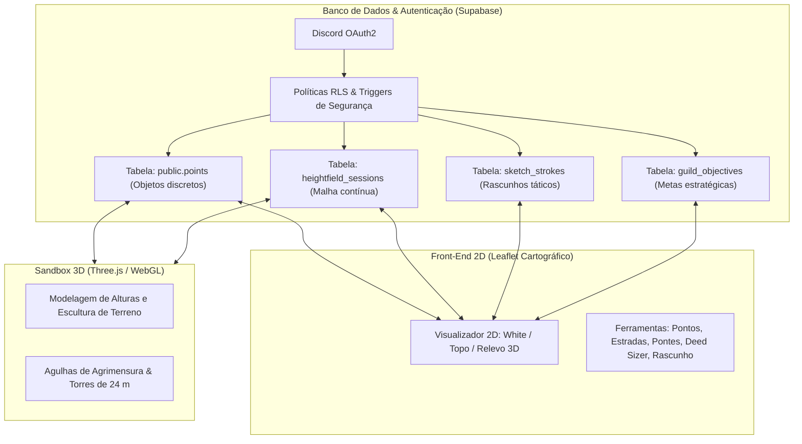

# 🗺️ Guia de Uso & Níveis de Acesso — Jackal Atlas (2D & 3D Sandbox)

Este documento descreve o funcionamento integral do **Jackal Atlas**, compreendendo a cartografia vetorial **2D**, o ambiente **Sandbox 3D de Relevo**, o sistema de coordenadas centrado no Spawn (Round 2) e a hierarquia de **permissões e segurança** (Row-Level Security & Roles).

---

## 1. Visão Geral da Arquitetura

O sistema opera com duas interfaces integradas sob a mesma base de dados (Supabase PostgreSQL):



- **Atlas 2D (`index.html`)**: Focado em **objetos discretos** (Deeds, torres, estradas, pontes, cavernas, minas, lodestones, pilares e metas estratégicas). Permite desenho tático rápido, medição de perímetros de assentamento e planejamento viário.
- **Sandbox 3D (`/sandbox/`)**: Focado no **relevo contínuo** (grade de elevação de 4 metros por tile, consenso por distância de observação e marcos de agrimensura em 3 dimensões).
- **Elo de Ligação**: As duas interfaces compartilham o mesmo sistema de coordenadas com origem no Spawn `(0, 0)`. Em qualquer ponto ou pilar do 2D, há o atalho *"Ver no Sandbox 3D ↗"* (`sandbox/#X,Y`), que abre a câmera 3D focada no local exato.

---

## 2. Níveis de Acesso e Permissões (Roles)

O controle de privilégios não é meramente cosmético no navegador; ele é garantido a nível de banco de dados por **Row-Level Security (RLS)** e **Triggers PostgreSQL**.

| Role | Cargo no Discord | O que pode ver | O que pode criar / editar | Aprovação de Dados |
| :--- | :--- | :--- | :--- | :--- |
| **`pending`** | Visitante / Recém-chegado | Modo somente leitura (mapa, relevo e anotações públicas) | Nenhuma escrita permitida | N/A |
| **`member`** | **Batedor (Scout)** | Todo o mapa 2D e relevo 3D | • Adicionar pontos comuns (`village`, `cave`, `beacon`, etc.) com status `reportado`<br>• Criar **📐 Marcos / Pilares 3D (`pillar`)**<br>• Traçar rascunhos pessoais (`draft`)<br>• Reportar ocorrências de beacons | Requer validação de Oficial ou Admin |
| **`officer`** | **Cartógrafo / Oficial** | Tudo, incluindo fila de moderação e dados pendentes | • Tudo de `member`<br>• Pontos criados entram como **`confirmado`** diretamente<br>• Pode **aprovar ou rejeitar** pontos pendentes de membros<br>• Pode **publicar (commit)** rascunhos táticos na camada oficial da guilda<br>• No Sandbox 3D: pode travar células de relevo e validar marcos | Aprova dados de membros |
| **`admin`** | **Comandante / Admin** | Acesso irrestrito a todos os dados e logs | • Tudo de `officer`<br>• Criar **🏷️ Topônimos / Regiões (`landmark`)**<br>• Criar e encerrar **Metas Estratégicas da Guilda**<br>• Alterar papéis (`roles`) de usuários no Painel Admin<br>• Executar reversões e snapshots do mapa | Autoridade máxima |

### 🛡️ Regras Especiais de Segurança no Banco

1. **Topônimos Administrativos (`landmark`)**:
   - Protegidos pela trigger `on_point_landmark_guard` (`check_landmark_admin_only`).
   - Somente quem tem role `admin` pode inserir ou atualizar um ponto com `kind = 'landmark'`.
   - Tentativas de injeção por usuários comuns são rejeitadas pelo PostgreSQL com exceção bloqueante.
2. **Marcos e Pilares 3D (`pillar`)**:
   - Possuem o tipo independente `pillar`.
   - **Liberados para todos os membros e batedores**. Permite que qualquer integrante em campo registre pilares de agrimensura sem esbarrar na trava de topônimo.
3. **Metas Estratégicas da Guilda**:
   - Apenas `admin` e `officer` podem publicar prioridades operacionais no painel superior direito.

---

## 3. Guia de Operação: Atlas 2D

### 3.1. Navegação e Seleção de Fundo
Na barra de ferramentas lateral esquerda (aba **Bases**), selecione a camada de exibição ideal:
- **📜 White**: Fundo neutro tipo pergaminho claro com grade vetorial de alto contraste, ideal para traçado de rotas e anotações rápidas.
- **⛰️ Topo**: Mapa topográfico hipsométrico com curvas de nível e cores indicativas de altitude (verde para planícies costeiras, tons ocres para colinas e marrom/cinza para picos).
- **🏔️ Relevo 3D**: Renderização dinâmica em tempo real com sombreamento de relevo (*hillshade* calculando azimute e elevação solar), destacando cristas montanhosas e vales profundos.

### 3.2. Sistema de Coordenadas e Setores
- **Ponto Central (0, 0)**: Localização aproximada do Spawn inicial.
- **Eixos**:
  - **X**: Leste positivo (`L`), Oeste negativo (`O`).
  - **Y**: Norte positivo (`N`), Sul negativo (`S`).
- **Setores (100×100 tiles)**: Cada quadrícula do mapa recebe uma sigla setorial (ex.: `N1-L2` = 100 tiles ao Norte, 200 tiles a Leste).
- **Busca Inteligente**: A barra de busca no topo aceita:
  - Nomes de vilas, deeds ou jogadores (ex.: `Jackal`, `Mitchel`).
  - Coordenadas diretas (ex.: `-150, 420` ou `X: 50 Y: -80`).
  - Siglas de setor (ex.: `N0-L1`, `S3-O2`).

### 3.3. Modos da Barra Superior

```
[ 👁️ Navegar ]  [ 📍 Anotar Ponto ]  [ 🛣️ Traçar Estrada ]  [ 🌉 Traçar Ponte ]  [ 📐 Medir Área ]  [ ✏️ Rascunho ]
```

1. **👁️ Navegar**: Modo padrão para arrastar, dar zoom, clicar em marcadores e inspecionar detalhes.
2. **📍 Anotar Ponto**: Clique em qualquer posição do mapa para abrir o formulário de cadastro.
   - Escolha o tipo: *Deed*, *Marco / Pilar 3D*, *Torre*, *Caverna*, *Minério*, *Beacon*, etc.
   - **Classe de Evidência**: Declare o método utilizado (*Contagem Construída* em estrada/pilar, *Contagem Caminhada* com picareta de bússola, *Estimativa Visual* ou *Regra do Jogo*).
3. **🛣️ Traçar Estrada**:
   - Clique sequencialmente no mapa para definir os nós da estrada.
   - O HUD inferior exibe em tempo real a distância total acumulada em tiles e metros.
   - Pressione **Salvar Estrada** para registrá-la como planejada ou construída.
4. **🌉 Traçar Ponte**:
   - Clique no ponto de partida e no ponto de ancoragem oposto sobre água ou desfiladeiro.
   - O sistema calcula o vão livre exato da ponte.
5. **📐 Medir Área (Deed Sizer)**:
   - Clique e arraste um retângulo sobre o terreno para simular a demarcação de um assentamento.
   - O crachá (*badge*) indica largura × altura em tiles, área total em tiles², custo estimado de manutenção e coordenadas do centro da Deed.
6. **✏️ Rascunho Tático (Sketch Layer)**:
   - Permite desenhar à mão livre, setas de investida, círculos de cerco, textos e carimbos (*stamps*) táticos.
   - Os traços começam em modo pessoal (`draft`) e podem ser consolidados para a guilda por Oficiais.

---

## 4. Guia de Operação: Sandbox 3D de Relevo

O Sandbox 3D é o ambiente de modelagem da topografia física do servidor.

### 4.1. Controles de Câmera
- **Botão Esquerdo do Mouse + Arrastar**: Orbita a câmera ao redor do ponto de mira.
- **Botão Direito do Mouse + Arrastar**: Translada a câmera lateralmente (*Pan*).
- **Roda do Mouse (Scroll)**: Zoom in / Zoom out.
- **Tecla [Space] ou Botão de Câmera Topo**: Alterna entre visualização perspectiva livre e ortográfica zenital (de cima para baixo).

### 4.2. Escultura e Registro de Alturas
- **Pintura de Relevo**: Permite aplicar altitudes estimadas aos vértices do terreno.
- **Regra de Consenso por Distância**:
  - Cada observação registrada carrega a distância até a estação de onde foi avistada.
  - Vistorias mais próximas têm maior peso probabilístico que avistamentos de longo alcance.
  - Células com divergência de medições são destacadas com textura de "disputa" até que um Oficial valide ou um novo batedor confirme no local.
- **Invariantes do Terreno**:
  - Toda água está rigorosamente no nível 0 (mar).
  - Escarpas não podem exceder a inclinação máxima de colapso de terreno do motor do jogo.
- **Marcos de Agrimensura (Pilares 3D)**:
  - Pilares construídos no mundo real a cada 50 ou 100 tiles servem como âncoras geométricas para amarração altimétrica.
  - Ao salvar um pino no Sandbox 3D, ele é sincronizado instantaneamente com o banco `points` com o tipo `pillar`.

---

## 5. Fluxo de Trabalho Recomendado para Batedores (Scouts)

1. **Partida do Spawn**:
   - O Spawn é o marco zero `(0, 0)` ao nível do mar (`Z = 0`).
2. **Rumo no Início do Servidor (Sem Bússola)**:
   - Coloque a **picareta no chão** do jogo para obter o alinhamento exato com o Norte da grade.
3. **Construção de Linhas de Referência**:
   - Avance contando tiles construídos em linha reta (estradas, cercas ou pilares a cada 50 tiles).
   - Ao parar, anote a posição no Atlas 2D selecionando a opção **📐 Marco / Pilar 3D** e o método **Contagem Construída**.
4. **Fechamento de Circuito**:
   - Sempre que possível, percorra um circuito fechado (ex.: 100 tiles Norte, 100 Leste, 100 Sul, 100 Oeste).
   - Se a chegada coincidir com o ponto inicial, o erro acumulado é zero e o pilar pode ser confirmado com alta confiança.
5. **Revisão por Oficiais**:
   - Os Oficiais da guilda abrem o painel de moderação, comparam os relatos de batedores independentes e transformam dados de campo em referências cartográficas permanentes.

---

## 6. Resumo de Atalhos de Teclado

| Tecla | Função no Atlas 2D | Função no Sandbox 3D |
| :---: | :--- | :--- |
| **`Esc`** | Cancela modo atual / Fecha modais abertos | Cancela ferramenta ativa |
| **`Y`** | Liga / Desliga grade visual | Alterna malha de arame (*wireframe*) |
| **`I`** | Alterna entre tema claro e tema escuro | Alterna iluminação ambiente |
| **`Space`** | Centraliza a visão no Spawn (0,0) | Alterna visão perspectiva / topo |
| **`Tab`** | Recolhe / Expande barra lateral esquerda | Oculta painel flutuante de ferramentas |
