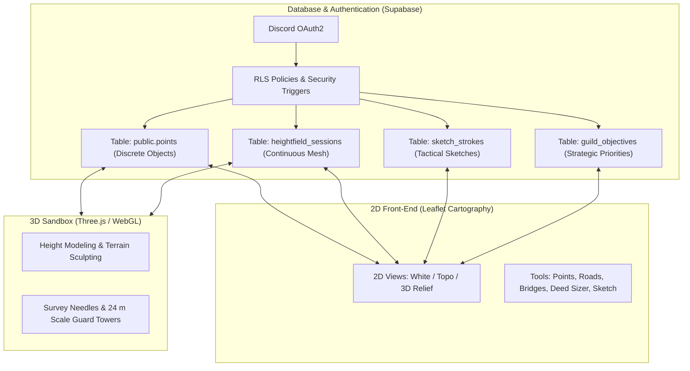

# 🗺️ User Guide & Access Levels — Jackal Atlas (2D & 3D Sandbox)

This document provides a comprehensive operational guide for the **Jackal Atlas**, covering the **2D vector cartography**, the **3D Relief Sandbox**, the Spawn-centered coordinate system (Round 2), and the **permissions & security architecture** (Row-Level Security & Roles).

---

## 1. System Architecture Overview

The system operates with two integrated interfaces sharing a single database (Supabase PostgreSQL):



- **2D Atlas (`index.html`)**: Focused on **discrete objects** (deeds, guard towers, roads, bridges, caves, mineral nodes, lodestones, survey pillars, and strategic priorities). Enables rapid tactical sketches, settlement perimeter measurement, and infrastructure planning.
- **3D Sandbox (`/sandbox/`)**: Focused on **continuous elevation** (4 meters per tile heightfield grid, consensus weighting based on observation distance, and 3D survey anchors).
- **Core Connection**: Both interfaces share the exact same coordinate system centered at Spawn `(0, 0)`. Any marker or pillar on the 2D map includes a *"View in 3D Sandbox ↗"* shortcut (`sandbox/#X,Y`) that opens the 3D camera centered directly on that target.

---

## 2. Roles, Access Levels & Permissions

Permissions are enforced at the database layer via **Row-Level Security (RLS)** and **PostgreSQL triggers**, rather than merely client-side interface toggles.

| Role | Discord Mapping | Visibility | Create / Edit Capabilities | Approval Rights |
| :--- | :--- | :--- | :--- | :--- |
| **`pending`** | Guest / New Member | Read-only access to map, terrain, and public notes | Cannot write or submit data | None |
| **`member`** | **Scout (Batedor)** | Full access to 2D & 3D viewports | • Add standard POIs (`village`, `cave`, `beacon`, etc.) marked as `reported`<br>• Create **📐 3D Survey Pillars / Markers (`pillar`)**<br>• Draw personal draft sketches (`draft`)<br>• Report field events for beacons | Requires approval by Officer/Admin |
| **`officer`** | **Cartographer / Officer** | Full access including moderation queue and pending data | • Everything available to `member`<br>• Submissions are saved as **`confirmed`** directly<br>• Can **approve or reject** pending scout submissions<br>• Can **commit** tactical sketches to the official guild layer<br>• In 3D Sandbox: can lock terrain cells and validate markers | Approves member data |
| **`admin`** | **Commander / Admin** | Unrestricted access to all data, queues, and logs | • Everything available to `officer`<br>• Create **🏷️ Place Names / Regions (`landmark`)**<br>• Create and complete Guild Strategic Objectives<br>• Manage user roles via Admin Panel<br>• Execute terrain rollbacks and snapshot backups | Highest authority |

### 🛡️ Critical Database Security Triggers

1. **Place Names & Toponyms (`landmark`)**:
   - Guarded by the database trigger `on_point_landmark_guard` invoking `check_landmark_admin_only()`.
   - Only accounts with the `admin` role are permitted to create or update records with `kind = 'landmark'`.
   - Unauthorized attempts by non-admins trigger an immediate PostgreSQL exception.
2. **3D Survey Pillars & Markers (`pillar`)**:
   - Assigned the dedicated point kind `pillar`.
   - **Accessible to all members and scouts**. Allows field scouts to log survey pillars without tripping the admin-only landmark trigger.
3. **Strategic Guild Objectives**:
   - Only `admin` and `officer` accounts can publish or alter strategic guild priorities displayed on the right sidebar.

---

## 3. Operations Guide: 2D Atlas

### 3.1. Navigation & Base Layers
In the left sidebar (**Bases** section), switch between three Round 2 base viewports:
- **📜 White**: Minimalist parchment/white background with a high-contrast coordinate grid, designed for route planning and high legibility.
- **⛰️ Topo**: Hypsometric contour map with altitude color ramps (green for coastal plains, ochre for foothills, brown/grey for peaks).
- **🏔️ 3D Relief**: Dynamic real-time hillshade canvas calculating solar azimuth and elevation to accentuate ridges, slopes, and valleys.

### 3.2. Coordinate System & Sectors
- **Central Origin (0, 0)**: Approximate location of the initial server Spawn at sea level ($Z = 0$).
- **Axes**:
  - **X**: Positive East (`E` / `L`), Negative West (`W` / `O`).
  - **Y**: Positive North (`N`), Negative South (`S`).
- **Sectors (100×100 tiles)**: Each grid cell is labeled with sector coordinates (e.g., `N1-E2` = 100 tiles North, 200 tiles East).
- **Universal Search**: The top search bar accepts:
  - Place names, deed titles, or player names (e.g., `Jackal`, `Mitchel`).
  - Direct coordinates (e.g., `-150, 420` or `X: 50 Y: -80`).
  - Sector acronyms (e.g., `N0-E1`, `S3-W2`).

### 3.3. Top Modes Bar

```
[ 👁️ Navigate ]  [ 📍 Add Point ]  [ 🛣️ Trace Road ]  [ 🌉 Trace Bridge ]  [ 📐 Measure Area ]  [ ✏️ Sketch ]
```

1. **👁️ Navigate**: Default inspection mode to pan, zoom, view point details, and copy coordinates in X,Y format.
2. **📍 Add Point**: Click anywhere on the map to open the point registration dialog.
   - Select point category: *Deed*, *3D Survey Pillar / Marker*, *Tower*, *Cave*, *Mineral Node*, *Beacon*, etc.
   - **Evidence Class**: Declare the survey method (*Built Count* along road/pillar/wall, *Walk Count* using footsteps and pickaxe bearing, *Visual Estimate*, or *Game Rule*).
3. **🛣️ Trace Road**:
   - Click consecutively along the planned path to lay road nodes.
   - The bottom HUD displays accumulated distance in tiles and meters in real time.
   - Click **Save Road** to record as planned or built.
4. **🌉 Trace Bridge**:
   - Click on the departure abutment and the opposing landing bank across water or ravines.
   - Calculates the span length in tiles.
5. **📐 Measure Area (Deed Sizer)**:
   - Click and drag a rectangle over the terrain to simulate deed sizing.
   - Displays width × height in tiles, total area in tiles², estimated upkeep cost, and center coordinates.
6. **✏️ Sketch Layer**:
   - Freehand brush, movement arrows, target circles, text annotations, and tactical stamps.
   - Strokes start as personal drafts (`draft`) and can be promoted to the guild layer by Officers.

---

## 4. Operations Guide: 3D Relief Sandbox

The 3D Sandbox is the collaborative environment for modeling real server topography.

### 4.1. Camera Controls
- **Left Mouse Button + Drag**: Orbit camera around focus point.
- **Right Mouse Button + Drag**: Pan camera laterally.
- **Mouse Scroll Wheel**: Zoom in / Zoom out.
- **[Space] Key or Top Camera Icon**: Toggle between 3D perspective and orthographic top-down view.

### 4.2. Terrain Sculpting & Elevation Consensus
- **Relief Painting**: Apply estimated altitudes to terrain vertices.
- **Distance-Weighted Consensus**:
  - Each observation stores the distance from the station where it was sighted.
  - Closer sightings have higher weight than distant estimates.
  - Conflicting elevation reports are highlighted with a contested visual pattern until validated by an Officer.
- **Physical Invariants**:
  - All ocean water sits strictly at elevation 0 (sea level).
  - Slope angles respect the maximum engine angle before dirt collapses.
- **Survey Needles (3D Pillars)**:
  - Pillars built every 50 or 100 tiles act as geometric anchors.
  - Saving a survey pin in the 3D Sandbox automatically writes to `public.points` with `kind: 'pillar'`.

---

## 5. Recommended Field Protocol for Scouts

1. **Spawn Departure**:
   - The server Spawn serves as origin `(0, 0)` at sea level ($Z = 0$).
2. **Early Server Bearing (Before Compass & Spyglass)**:
   - Place a **pickaxe on the ground** to read the exact North alignment of the world grid.
3. **Constructed Reference Lines**:
   - Advance along straight tile counts (roads, fences, or stone pillars every 50 tiles).
   - Log the station in Atlas 2D as **📐 3D Survey Pillar / Marker** using the **Built Count** evidence method.
4. **Circuit Closure**:
   - Whenever possible, traverse a closed loop (e.g., 100 tiles North, 100 East, 100 South, 100 West).
   - If the return point matches the departure origin, accumulated error is zero, confirming high-certainty calibration.
5. **Officer Review**:
   - Officers review field submissions, correlate independent scout reports, and promote provisional markers into official cartographic anchors.

---

## 6. Keyboard Shortcuts Reference

| Key | 2D Atlas Action | 3D Sandbox Action |
| :---: | :--- | :--- |
| **`Esc`** | Cancel active mode / close modals | Cancel active tool |
| **`Y`** | Toggle 100×100t sector grid overlay | Toggle wireframe view |
| **`I`** | Toggle light / dark map styling | Toggle ambient scene lighting |
| **`Space`** | Center viewport on Spawn (0, 0) | Toggle perspective / orthographic top-down |
| **`Tab`** | Collapse / expand left sidebar | Hide / show tool overlay |
